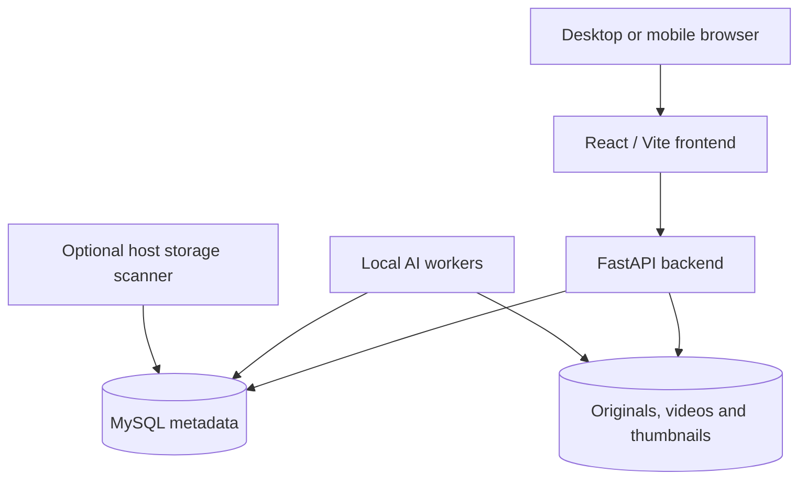

<div align="center">

# LocalLens

### Because you have clouds at home.

**Own your photos. Own your storage. Own your cloud.**

A privacy-focused, self-hosted photo and video library for your household—without requiring a third-party cloud-storage subscription.

</div>

> **Development status · November 2026:** LocalLens is actively developed and is not yet a production release. This README combines capabilities documented in the project with features delivered through incremental patch packages. **v0.6.25 is the latest prepared patch discussed here, not a verified version installed on the server or published to GitHub.** Check your running installation and each patch's installation notes before relying on a feature.

## Why LocalLens?

LocalLens gives you the convenience of a searchable photo gallery while keeping your original media on storage you control. It is built for private, multi-user libraries, browser-based access even from your mobile device and optional AI processing for smarther searching on your own server.

- **Your originals stay yours.** Store full-quality photos, videos, and supported Live Photo components on your host filesystem.
- **A library for everyone.** Separate accounts, private galleries, albums, and controlled sharing.
- **Find what matters.** Search filenames, tags, people, and more, with optional local AI indexing.
- **Understand your storage.** Administrator tools show disk utilization, database structure, and background jobs.

## Features

| Area | Capabilities |
| --- | --- |
| **Photos & videos** | Browser upload, galleries, previews, thumbnails, video playback, favorites, recently added, sorting, pagination, and original-quality downloads |
| **Organization** | Albums, gallery search, duplicate-photo detection, recycle bin, restoration, and deletion controls |
| **Apple media** | HEIC/HEIF handling; supported Live Photo still + motion pairing; preserve originals and available metadata |
| **Accounts & security** | Multi-user authentication, private libraries, admin-managed users, account settings, storage quotas, and session management |
| **Shared libraries** | Permission-aware shared albums and media access |
| **Smart Library** | Optional local object tagging, face detection and recognition, name review, AI-assisted search, and scan/job status |
| **Media export** | Download originals individually; optional selected-original ZIP export, including paired Live Photo motion files (v0.6.20) |
| **Location search** | Optional private location labels derived from photo GPS data with an offline place database (v0.6.20) |
| **Administration** | User management, storage accounting, schema inspection, interactive ER diagrams, and background worker monitoring |

### Private AI features

LocalLens is designed to analyze media on your server instead of sending originals to a hosted recognition API. Documented components include OpenCLIP for content tags and OpenCV-based face detection.

Manual name corrections take precedence over automatic ID's. AI facial recognition can be wrong, so these features depend on your corrections, supported media, and installed patches. Initial model and dependency downloads may require internet access. Individual pet recognition across multiple photos is **not yet fully verified**.

### Storage dashboard

Administrator storage reporting includes a full-disk utilization view, exploring details through clickable regions for folder drill-downs, and separate reports for photos/videos, MySQL tables and indexes, and Docker images, volumes, and build cache.

**The disk-capacity chart is the servers current usage.** Separate MySQL, media, and Docker reports can overlap, so their numbers should not be added together.

### MySQL ER diagram

The interactive database diagram shows **solid declared foreign-key relationships** (enforced by MySQL) and **dashed inferred application references** logical links, not database constraints).

## Technology stack

| Component | Technology |
| --- | --- |
| Frontend | React, Vite, JavaScript / JSX |
| Backend | Python, FastAPI, Uvicorn, Pydantic |
| Database | MySQL 8.x (8.4 documented in the project) |
| Authentication | JWT-based sessions; password hashing and security controls documented by the project |
| Image processing | Pillow, Pillow-HEIF; FFmpeg/FFprobe for supported video workflows |
| Local AI | PyTorch, OpenCLIP, OpenCV, NumPy; background workers |
| Containers | Docker Engine, Docker Compose |
| Reverse proxy | Caddy (documented deployment) |
| Server environment | Ubuntu Linux |

## How it works



Original media is stored on the filesystem, **not** as MySQL blobs. MySQL tracks accounts, albums, metadata, tags, associations, and background-job state. Background services handle indexing and, when installed, host-storage reporting.

## Development roadmap

The checkboxes below combine the original README's feature roadmap with more recent prepared development work. **Checked means documented as implemented or developed, not independently verified as installed on every host.**

- [x] Core infrastructure and MySQL metadata architecture
- [x] Multi-user accounts, authentication, and private libraries
- [x] Administrator dashboard and storage quotas
- [x] Photo upload, albums, favorites, trash and restoration
- [x] HEIC/HEIF image handling and browser previews
- [x] Video playback and supported Live Photo handling
- [x] Search, sorting, pagination, and original downloads
- [x] Local image tagging and face recognition workflows
- [x] Interactive ER diagram and storage reporting (prepared patches)
- [x] Optional bulk downloads and private location tags (prepared patches)
- [ ] Confirm end-to-end RAW camera format support and metadata preservation
- [ ] Complete HTTPS and secure remote-access setup/documentation
- [ ] Dedicated iOS and Android applications
- [ ] Automatic mobile backup workflows
- [ ] Production-ready installation and upgrade process
- [ ] Production release

## Installation and operation

**There is not yet a complete, supported clean-install guide.** LocalLens currently uses development-time Docker Compose configuration and incremental patches. Do not interpret the commands below as instructions for a new deployment.

For an **existing configured installation** on Ubuntu:

```bash
cd ~/local-lens
docker compose ps
docker compose up -d --build backend frontend
```

The local URL depends on your host networking and reverse-proxy configuration. Do not expose the development instance directly to the internet without reviewing authentication, TLS, network restrictions, and storage permissions.

### Check database structure

```bash
cd ~/local-lens
docker compose exec db sh -lc 'exec mysql -u"$MYSQL_USER" -p"$MYSQL_PASSWORD" "$MYSQL_DATABASE"'
```

At the MySQL prompt:

```sql
SHOW TABLES;
SHOW CREATE TABLE ai_face_reviews\G
```

Use `exit;` to leave MySQL.

### Back up before upgrading

```bash
cd ~/local-lens
mkdir -p backups
BACKUP="backups/locallens-$(date +%Y%m%d-%H%M%S).sql"
docker compose exec -T db sh -lc \
  'exec mysqldump --single-transaction --no-tablespaces -u"$MYSQL_USER" -p"$MYSQL_PASSWORD" "$MYSQL_DATABASE"' \
  > "$BACKUP"
test -s "$BACKUP" && echo "MySQL backup created: $BACKUP"
```

**Important:** A MySQL dump does not contain your original photos or videos. Maintain independent media backups and verify that both database and media backups can be restored.

### Recent prepared patches

| Version | Main changes | Notes |
| --- | --- | --- |
| v0.6.18–v0.6.19 | Pagination and download refinements | Verify installed behavior |
| v0.6.20 | Private GPS-based tags and bulk-original ZIP downloads | Additional migration and worker |
| v0.6.21 | Storage inventory and integrity-review tools | Published host snapshot required |
| v0.6.22 | Whole-disk chart and clickable usage reports | Builds on v0.6.21 |
| v0.6.24 | Fresh host rescan, breadcrumb fix, five-column ER layout and inferred-label cleanup | Includes v0.6.23 changes; optional systemd worker |
| v0.6.25 | Color-coded ER relationship labels | Prepared styling patch; follow its compatibility instructions |

Each patch has its own preflight, migration, and rollback notes. **Do not assume patch numbers can be skipped or that a prepared patch is already live.** Back up data, run the read-only compatibility check, and review the patch README before installing.

To inspect Docker disk use:

```bash
docker system df
docker builder du
```

## Privacy and security

LocalLens is built to keep media on infrastructure you own. Photo analysis is intended to run locally; optional location labels use local place data rather than an external geocoding request. Accounts and shared-media workflows use access checks, but security still depends on correct server setup and deployed code.


## Contributing and project status

LocalLens is a work in progress. Feedback and bug reports are welcome through the repository's issue tracker, if enabled. Please include your installed version, relevant logs with secrets removed, and reproduction steps.

Licensing and contribution rights depend on the repository's actual `LICENSE` and contribution documents; the existence of a public repository alone does not grant reuse rights.

---

<div align="center">

**LocalLens** — *Because you have clouds at home.*

</div>
